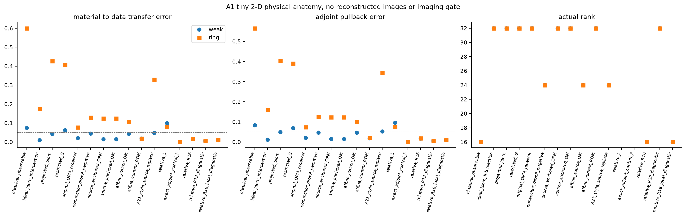
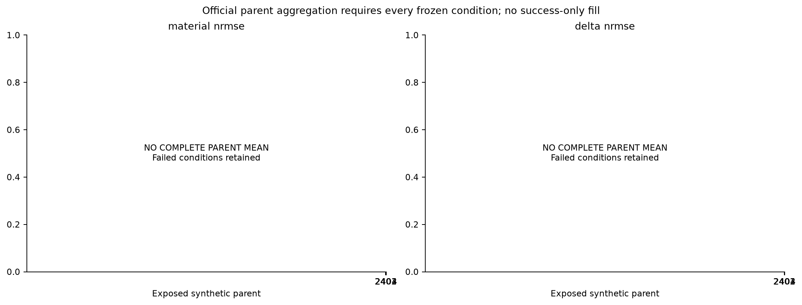
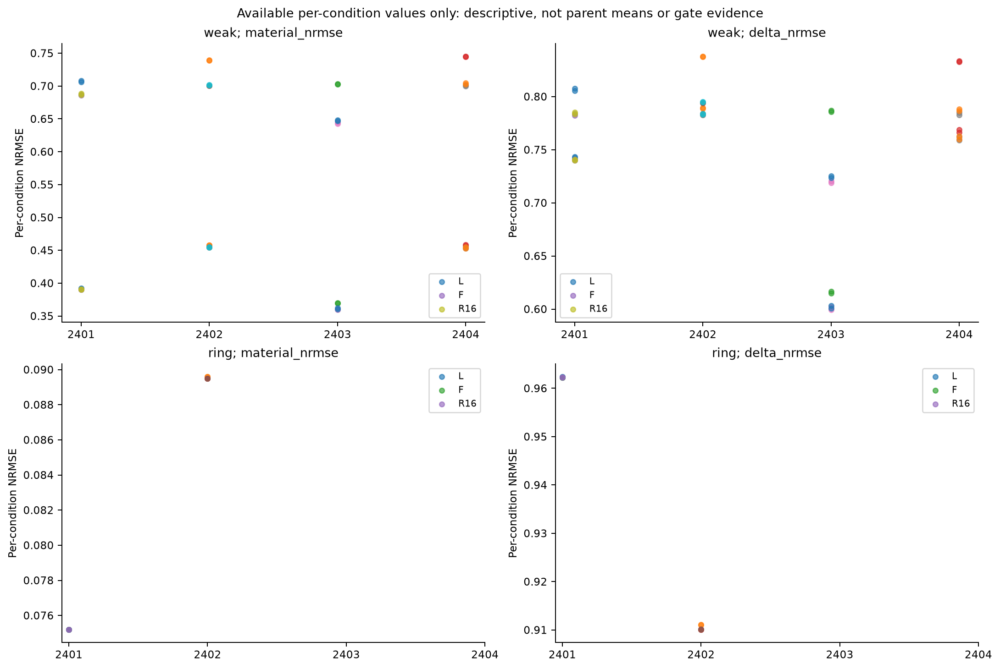
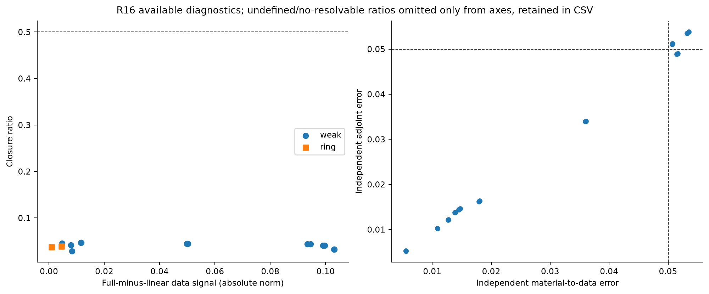
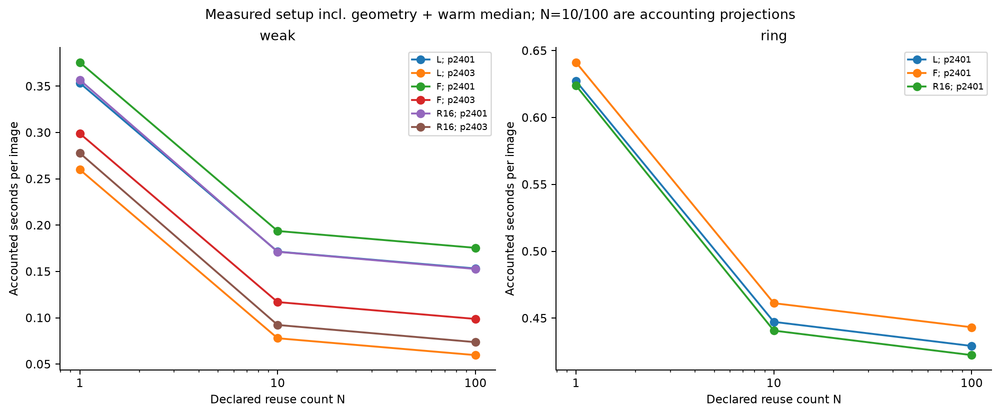
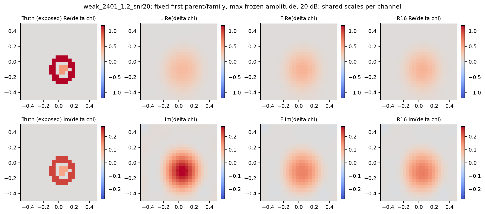
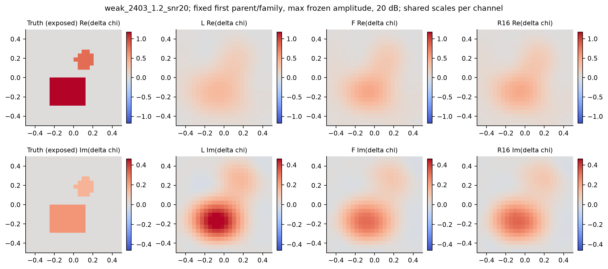
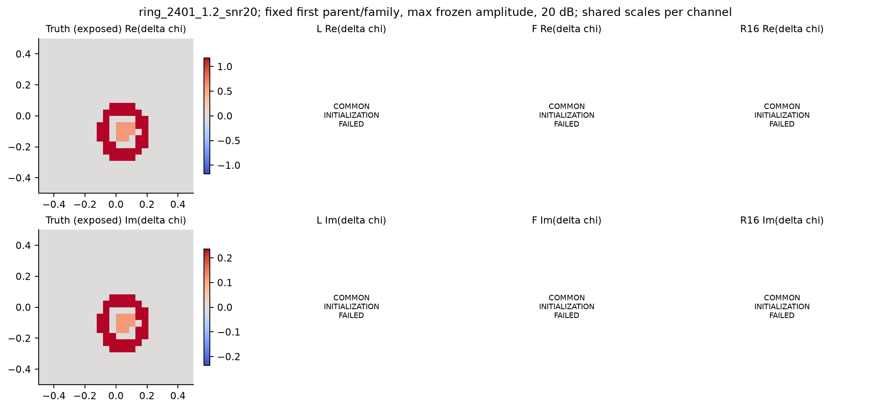
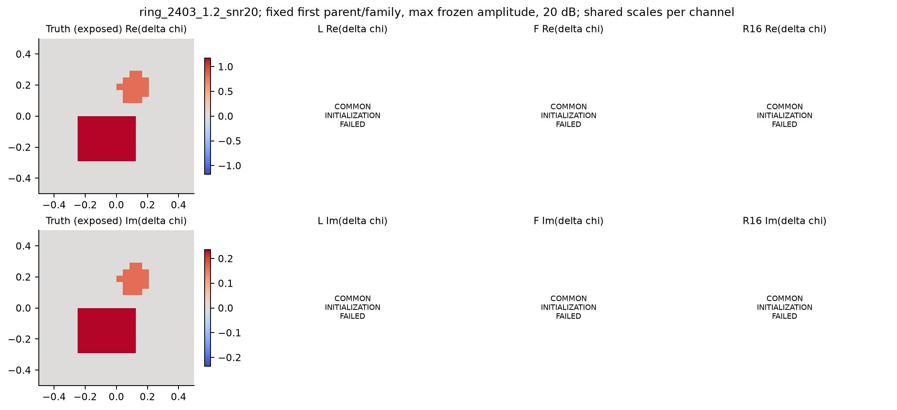

# A24：source-anchored OM 与 relative feedback 研究报告

协议：`A24-NO-NN-20261008-v1`。生成时间：2026-10-08T12:45:29.558483+00:00。
本报告已由 Codex 完成科学审阅；详细因果边界见 [科学审阅记录](docs/SCIENTIFIC_REVIEW.md)。
当前冻结 Gate decision：`CURRENT_COMPRESSED_FEEDBACK_NO_GO`。

**结论：当前无 NN rank16 压缩架构没有通过充分性门槛。** 47 项最终测试
支持实现一致性；6 个有效独立任务条件违反 5% 误差要求，Gate2 为 FAIL。
强背景初始化失败使正式成像配对不足，Gate3 保持 HOLD。
成功图像未达到共同质量区，Gate5 为 QUALITY_TARGET_NOT_REACHED。
弱背景等权 parent 子组的 F 改善为 3.98%，不能替代完整协议的 10% 门槛。
停止 3D、NN 与实验扩展。不能把这些结果解释为相对 Maxwell 恒等式错误，
也不能称为已证实的成像或加速算法。

## 1. 从最开始最基础的 literature review 和 background

逆散射由外部电磁观测恢复材料。材料改变内部场，内部场又决定材料诱导电流，
因此一次线性回投不能自动保留多重散射。SOM/TSOM处理数据可确定与模糊电流；
内部传播谱截断与已知照明forcing的种子分解是不同操作。
已有背景、prior、affine lifting及低秩消元构成这里的比较基础。
closest prior与原文取得层级见 [来源与阅读账本](theory/SOURCES_AND_READING_LEDGER.md)；
这些背景解释不等于本实验建立新的理论结论。

固定参考材料给出已知场 e_b 和数据 y_b。相对材料源 w 汇集材料变化引起的新响应，
反馈算子把这个响应再次传播回材料内部。完整关系是
`w=(I-H G_b)^(-1) H e_b`、`y=y_b+D_b w`，其中 `H=diag(a(chi)-a(chi_b))`。
L保持完整本构转换但去掉相对反馈；F在当前合法估计处使用完整物理反馈及伴随；
R16仅将内部传播替换成预注册低秩近似。F没有读取truth-state Jacobian。
共同TV和共同初始化用于避免把不同材料先验的收益算成反馈收益。

当同一U包含全部参考source currents时，可删的是已为零的forcing-P。
它不允许在换U或换receiver方向后宣称“P本身无效”。TSOM的intersection、projection
与restricted-G空间也不能混写。相应边界见
[代数审计](theory/TSOM_SOMNET_ALGEBRA_AUDIT.md)、
[理论与反例](theory/THEOREMS_AND_COUNTEREXAMPLES.md)、
[relative架构](theory/RELATIVE_FEEDBACK_OM_ARCHITECTURE.md)。

## 2. 证据层级与冻结范围

| 层级 | 实测状态 | 解释范围 |
| --- | --- | --- |
| 理论 | FORMULAS_AND_COUNTEREXAMPLES_ONLY | 来源 theory/；不产生图像或速度结论 |
| A0/unit | PASS | 离散代数与实现核验；不能替代成像 |
| A1 tiny 2D | COMPLETE | 8×8空间剖析；无材料重建图像 |
| B0 2D imaging | {"OK": 136, "FAILED": 4, "COMMON_INITIALIZATION_FAILED": 84} | 四个已公开合成parent，失败条件全部保留 |
| 3D dyadic DDA | NOT_RUN | 有条件最多4状态；不能将2D解释成3D |
| 时间/成本 | QUALITY_TARGET_NOT_REACHED | 实测warm与组成计费；N=10/100未实际重复部署 |
| NN训练 | NOT_RUN_TRAINING_DISABLED | C/D保持关闭 |

二维主平台为24×24 TM Helmholtz VIE，
8 sources、32 receivers，完整材料mass坐标，
双背景、四parent、双幅度与无噪/20 dB，共32观测条件。
224个方法条件记录中状态分布为 `{'OK': 136, 'FAILED': 4, 'COMMON_INITIALIZATION_FAILED': 84}`。
32个观测条件共享四个几何parent；不能当作32个独立对象。
这些parent及其生成配置已暴露，无blind holdout或泛化统计证据。

2D使用原A2离散核，时间约定exp(-i omega t)、outgoing i H0^(1)/4 Green，
off-diagonal包含k² cell area，self cell沿用等面积圆盘积分。
其本构a(chi)=chi、a'=1。因此2D的linear-a加exact conversion与L相同，
不能声称检验了3D非线性极化率。三维分支沿用冻结A20/A23 dyadic DDA、
原polarizability/a'及absorbed self-term；不同质量归一与三分量电流合同独立实现。
物理源版本见 [SOURCE_MANIFEST.json](SOURCE_MANIFEST.json)，不新增SHA256检查。

全部方法使用同一mass度量、Re/Im联合各向同性TV、物理box
Re[-0.5,4.0]、Im[0.0,0.5]，
同一K=3更新和最多一次half-step retry。
TV rule：`lambda=0.01*(1+sigma/background_data_RMS); normalized data loss .5||W residual||^2/||W yb||^2; same physical prior in every arm`。step rule：`0.8/lambda_max(Jb^T Jb/||yb||^2) in real mass coordinates; single global fixed step per background`。
prox固定上限2000，KKT tolerance=1e-06；
没有事后放宽容差、加迭代、改rank或换先验。

## 3. 实现核验与tiny anatomy

| job | tests | failures | errors | passed |
| --- | --- | --- | --- | --- |
| a24-a-001 | 43 | 0 | 0 | True |
| a24-a-002 | 45 | 0 | 0 | True |
| a24-a-003 | 47 | 0 | 0 | True |

Anatomy身份判据：`PASS`，
scope：`A0/A1 algebra and tiny 2D physical anatomy only`；共32条空间诊断。
同U anchor pair与Schur/adjoint一致性来自这些核验；它们没有重建图像。
剖析原始plot data保留actual ranks、材料→数据与adjoint任务误差、负向control与失败。
`offline_s`中共享setup可在多条记录描述性重复，不能直接把这些行求和当总成本。

## 4. 二维成像、完整parent与失败

| 方法 | 全部状态 | 达到联合quality数量 |
| --- | --- | --- |
| L | {"OK": 20, "COMMON_INITIALIZATION_FAILED": 12} | 0 |
| F | {"OK": 20, "COMMON_INITIALIZATION_FAILED": 12} | 0 |
| R16 | {"OK": 20, "COMMON_INITIALIZATION_FAILED": 12} | 0 |
| R32_DIAGNOSTIC | {"OK": 20, "COMMON_INITIALIZATION_FAILED": 12} | 0 |
| R16_LOCAL_DIAGNOSTIC | {"OK": 20, "COMMON_INITIALIZATION_FAILED": 12} | 0 |
| AFFINE_ROM32 | {"OK": 20, "COMMON_INITIALIZATION_FAILED": 12} | 0 |
| BORN_TV | {"OK": 16, "FAILED": 4, "COMMON_INITIALIZATION_FAILED": 12} | 0 |

下面只在每个parent全部8个条件都有效时给出official mean；缺少或失败的条件
不填零、不做success-only主均值。其余已获得的单条件图像仅作描述性检查。

| parent | family | 方法 | valid | expected | official full-chi NRMSE |
| --- | --- | --- | --- | --- | --- |
| 2401 | multiscale_shell | L | 6 | 8 | — |
| 2401 | multiscale_shell | F | 6 | 8 | — |
| 2401 | multiscale_shell | R16 | 6 | 8 | — |
| 2401 | multiscale_shell | R32_DIAGNOSTIC | 6 | 8 | — |
| 2401 | multiscale_shell | R16_LOCAL_DIAGNOSTIC | 6 | 8 | — |
| 2401 | multiscale_shell | AFFINE_ROM32 | 6 | 8 | — |
| 2401 | multiscale_shell | BORN_TV | 4 | 8 | — |
| 2402 | multiscale_shell | L | 6 | 8 | — |
| 2402 | multiscale_shell | F | 6 | 8 | — |
| 2402 | multiscale_shell | R16 | 6 | 8 | — |
| 2402 | multiscale_shell | R32_DIAGNOSTIC | 6 | 8 | — |
| 2402 | multiscale_shell | R16_LOCAL_DIAGNOSTIC | 6 | 8 | — |
| 2402 | multiscale_shell | AFFINE_ROM32 | 6 | 8 | — |
| 2402 | multiscale_shell | BORN_TV | 4 | 8 | — |
| 2403 | asymmetric_piecewise | L | 4 | 8 | — |
| 2403 | asymmetric_piecewise | F | 4 | 8 | — |
| 2403 | asymmetric_piecewise | R16 | 4 | 8 | — |
| 2403 | asymmetric_piecewise | R32_DIAGNOSTIC | 4 | 8 | — |
| 2403 | asymmetric_piecewise | R16_LOCAL_DIAGNOSTIC | 4 | 8 | — |
| 2403 | asymmetric_piecewise | AFFINE_ROM32 | 4 | 8 | — |
| 2403 | asymmetric_piecewise | BORN_TV | 4 | 8 | — |
| 2404 | asymmetric_piecewise | L | 4 | 8 | — |
| 2404 | asymmetric_piecewise | F | 4 | 8 | — |
| 2404 | asymmetric_piecewise | R16 | 4 | 8 | — |
| 2404 | asymmetric_piecewise | R32_DIAGNOSTIC | 4 | 8 | — |
| 2404 | asymmetric_piecewise | R16_LOCAL_DIAGNOSTIC | 4 | 8 | — |
| 2404 | asymmetric_piecewise | AFFINE_ROM32 | 4 | 8 | — |
| 2404 | asymmetric_piecewise | BORN_TV | 4 | 8 | — |

共同初始化的TV prox未达到冻结KKT阈值会使所有方法标记
`COMMON_INITIALIZATION_FAILED`。这些是共同优化入口的瓶颈，不能解释为Maxwell
恒等式或G1失败，也不能从主比较移除。单方法的`FAILED`另行保留。
failure ledger：16条；未输出材料的条件：88条。
raw condition矩阵见 [condition_plot_data.csv](results/report/plot_data/condition_plot_data.csv)，
完整失败行见 [condition_failures.csv](results/report/plot_data/condition_failures.csv)。

closure分母低于实际noise norm或数值floor时为NO_RESOLVABLE_FEEDBACK：
rho未定义，不填0，也不将小ratio当证据。此状态与未运行、预测失败分别保存。
独立task audit在同一在线R估计处使用固定material probes/data loads，
其已获诊断不能补足缺失条件。普通adjoint与F使用同一完整离散forward/adjoint合同。

### 4.1 同条件配对的描述性background子组

下表只比较同一条件的L/F/R16，按每个parent先计算平均与百分比gain。
weak背景每个parent四条件完整，因此允许四parent等权的weak子组描述；
它不等于预注册跨两背景的full-eight official parent mean。
ring的部分配对值保留，但不组成完整四parent背景均值，不用于Gate3。

| 背景 | parent | 成对条件 | 应有 | L NRMSE | F NRMSE | R16 NRMSE | F改善% | R改善% | R保留比 |
| --- | --- | --- | --- | --- | --- | --- | --- | --- | --- |
| weak | 2401 | 4 | 4 | 0.54949 | 0.53842 | 0.539026 | 2.0146 | 1.90434 | 0.945271 |
| weak | 2402 | 4 | 4 | 0.598533 | 0.577653 | 0.578101 | 3.48854 | 3.41372 | 0.978554 |
| weak | 2403 | 4 | 4 | 0.536332 | 0.502102 | 0.504533 | 6.38222 | 5.92905 | 0.928996 |
| weak | 2404 | 4 | 4 | 0.601231 | 0.576989 | 0.578866 | 4.03209 | 3.71988 | 0.922567 |
| ring | 2401 | 2 | 4 | 0.0752007 | 0.0751887 | 0.0751889 | 0.0160139 | 0.0158025 | 0.986796 |
| ring | 2402 | 2 | 4 | 0.0895988 | 0.0894996 | 0.0895012 | 0.110712 | 0.108926 | 0.983869 |
| ring | 2403 | 0 | 4 | — | — | — | — | — | — |
| ring | 2404 | 0 | 4 | — | — | — | — | — | — |

| 背景 | 完整parent数 | 等权L | 等权F | 等权R16 | parent等权F改善% | parent等权R改善% | 范围 |
| --- | --- | --- | --- | --- | --- | --- | --- |
| weak | 4 | 0.571397 | 0.548791 | 0.550131 | 3.97936 | 3.74175 | COMPLETE_WEAK_SUBGROUP_DESCRIPTION |
| ring | 0 | — | — | — | — | — | NO_EQUAL_PARENT_SUBGROUP_AGGREGATE |

同一合法R16估计处的已获task范围如下；20个可用估计不替换应有32个条件。
范围是已观测值的描述，不给缺失条件赋值。

| 任务量 | 可用条件 | 应有条件 | min | median | max |
| --- | --- | --- | --- | --- | --- |
| independent_transfer_error | 20 | 32 | 0.00552293 | 0.0163242 | 0.0535177 |
| independent_adjoint_error | 20 | 32 | 0.00524809 | 0.0154174 | 0.0537776 |
| gradient_cosine | 20 | 32 | 0.995264 | 0.999474 | 0.999992 |
| independent_state_data_error | 20 | 32 | 3.21638e-05 | 0.00151497 | 0.00918908 |

## 5. 缺失与等价基线

| baseline | 合同或缺失原因 |
| --- | --- |
| DRESSED_LINEAR_CHI | L |
| LINEAR_A_EXACT_CONVERSION_2D | L |
| ORDINARY_ADJOINT_TV | F |
| SOM_FFT_TSOM | NOT_COMPARABLE: existing Gaussian-parameter fit changes material prior and optimizer |
| CIE_I_WT_TSOM | NOT_IMPLEMENTED |

可靠迭代SOM/FFT-TSOM、CIE-I/WT-TSOM的缺失仍限制全算法优越性判断。
已实现的空间anatomy或Gaussian参数拟合不能替代同full-grid prior的这些基线。
R32和local R16为预注册diagnostic arms，不能在test后择优替代primary R16。

## 6. Gate原样记录与科学范围

| Gate | 保存状态 | 冻结阈值 |
| --- | --- | --- |
| G1 | PASS | 1e-10 |
| G2 | FAIL | {"task_max": 0.05, "cosine_min": 0.99, "image_degradation_max": 0.05} |
| G3 | HOLD | {"F_improvement": 0.1, "R_gain_retention": 0.8, "rho_closure_max": 0.5} |
| G4 | NOT_RUN_TRAINING_DISABLED | — |
| G5 | QUALITY_TARGET_NOT_REACHED | 0.2 |

G2保存状态为`FAIL`；
已观测独立任务反例数为6。任何有效条件超过冻结5%任务误差
或低于0.99方向cosine即可否定“所有条件均满足”的当前R16充分性要求，
缺失条件不能擦除这个反例。因此observed-task FAIL与image coverage不足分开记录。
G3保存状态为`HOLD`；HOLD来自完整parent图像比较不足，
不是由R16任务反例自动判定F反馈headroom不存在。G1身份核验的PASS也不抵消任务反例。
F headroom、R gain retention与两家族支持只按保存的完整parent合同判断。
G5保存joint-quality命中数为0；
`QUALITY_TARGET_NOT_REACHED`下不能从较差图像的时间称更快成像算法。
最终判断已结合失败、完整full-data验证及缺失baseline；详细依据见科学审阅记录。

| 已观测反例 | material-transfer error | adjoint error | gradient cosine |
| --- | --- | --- | --- |
| weak_2402_1.2_zero | 0.0506979 | 0.0510996 | 0.997589 |
| weak_2402_1.2_snr20 | 0.0507192 | 0.0512131 | 0.997621 |
| weak_2403_1.2_zero | 0.0516552 | 0.0490487 | 0.995264 |
| weak_2403_1.2_snr20 | 0.0514967 | 0.0488278 | 0.995353 |
| weak_2404_1.2_zero | 0.0535177 | 0.0537776 | 0.996696 |
| weak_2404_1.2_snr20 | 0.0532317 | 0.0534903 | 0.996768 |

首次controller缺失优先的历史结果保存在
[GATE_DECISION_INITIAL_CONTROLLER.json](results/b0/GATE_DECISION_INITIAL_CONTROLLER.json)。
父线程修正了已观测反例与覆盖不足的判定优先级；阈值、数值结果与冻结协议未改，
未为此重跑物理或成像。本报告只读取修正后保存决策。

## 7. 成本、cold/warm与N=1/10/100

计时只报告预注册矩阵中的实际重复，warm包含共同初始化与三步重建。
一次内存中部署setup包括image记录的shared background、method setup及对应job实测
`tm2d_geometry_setup`。cache export是科学存档I/O，计入inclusive science job time，
不强加给内存中部署setup。job001完成全部weak16条件及ring/2401/幅度.3的两条件；
job002从checkpoint补齐其它记录。成功image使用这一透明恢复边界关联几何成本。
原`cold_image_s`没有geometry，`cold_in_memory_image_s=raw cold_image_s+实际job geometry`。
表中另给`setup+warm median`的计费组成；不将它假称新测cold deployment。
restart的setup全部进入实际job总wall；表中的同一setup仅重复展示给不同N，不能求和。
无法关联setup与job时cold为空，不假定geometry免费。

N=1的cold组成=`setup+warm`，N=10/100的每图摊销=`warm+setup/N`，
total=`setup+N*warm`。它们是实测组成的计费投影，N次完整部署未执行。
剩余cache/data I/O、失败、独立评价与reporting都在inclusive job wall内，
未单独分段I/O不按0隐藏，也不虚构每次重新setup。
必须从磁盘加载保存cache的cold部署未计时，保持`disk_loaded_cache_status=NOT_RUN`。
这里的cold为内存中setup与重建组成，不包含完整程序启动或磁盘cache加载的实测。

| condition | method | N | 有效重复 | geometry s | 一次setup s | warm median s | 实测组成cold s | 摊销/image s | status |
| --- | --- | --- | --- | --- | --- | --- | --- | --- | --- |
| weak_2401_0.3_snr20 | L | 1 | 5 | 0.184766 | 0.202276 | 0.151254 | 0.354778 | 0.353531 | COMPLETE |
| weak_2401_0.3_snr20 | L | 10 | 5 | 0.184766 | 0.202276 | 0.151254 | 0.354778 | 0.171482 | COMPLETE |
| weak_2401_0.3_snr20 | L | 100 | 5 | 0.184766 | 0.202276 | 0.151254 | 0.354778 | 0.153277 | COMPLETE |
| weak_2401_0.3_snr20 | F | 1 | 5 | 0.184766 | 0.202235 | 0.17352 | 0.375873 | 0.375755 | COMPLETE |
| weak_2401_0.3_snr20 | F | 10 | 5 | 0.184766 | 0.202235 | 0.17352 | 0.375873 | 0.193744 | COMPLETE |
| weak_2401_0.3_snr20 | F | 100 | 5 | 0.184766 | 0.202235 | 0.17352 | 0.375873 | 0.175543 | COMPLETE |
| weak_2401_0.3_snr20 | R16 | 1 | 5 | 0.184766 | 0.20618 | 0.150655 | 0.356738 | 0.356835 | COMPLETE |
| weak_2401_0.3_snr20 | R16 | 10 | 5 | 0.184766 | 0.20618 | 0.150655 | 0.356738 | 0.171273 | COMPLETE |
| weak_2401_0.3_snr20 | R16 | 100 | 5 | 0.184766 | 0.20618 | 0.150655 | 0.356738 | 0.152717 | COMPLETE |
| weak_2403_0.3_snr20 | L | 1 | 5 | 0.184766 | 0.202276 | 0.0577324 | 0.26021 | 0.260009 | COMPLETE |
| weak_2403_0.3_snr20 | L | 10 | 5 | 0.184766 | 0.202276 | 0.0577324 | 0.26021 | 0.07796 | COMPLETE |
| weak_2403_0.3_snr20 | L | 100 | 5 | 0.184766 | 0.202276 | 0.0577324 | 0.26021 | 0.0597551 | COMPLETE |
| weak_2403_0.3_snr20 | F | 1 | 5 | 0.184766 | 0.202235 | 0.0967811 | 0.299385 | 0.299016 | COMPLETE |
| weak_2403_0.3_snr20 | F | 10 | 5 | 0.184766 | 0.202235 | 0.0967811 | 0.299385 | 0.117005 | COMPLETE |
| weak_2403_0.3_snr20 | F | 100 | 5 | 0.184766 | 0.202235 | 0.0967811 | 0.299385 | 0.0988034 | COMPLETE |
| weak_2403_0.3_snr20 | R16 | 1 | 5 | 0.184766 | 0.20618 | 0.0716844 | 0.27774 | 0.277864 | COMPLETE |
| weak_2403_0.3_snr20 | R16 | 10 | 5 | 0.184766 | 0.20618 | 0.0716844 | 0.27774 | 0.0923024 | COMPLETE |
| weak_2403_0.3_snr20 | R16 | 100 | 5 | 0.184766 | 0.20618 | 0.0716844 | 0.27774 | 0.0737462 | COMPLETE |
| ring_2401_0.3_snr20 | L | 1 | 5 | 0.184766 | 0.200019 | 0.427261 | 0.624411 | 0.62728 | COMPLETE |
| ring_2401_0.3_snr20 | L | 10 | 5 | 0.184766 | 0.200019 | 0.427261 | 0.624411 | 0.447263 | COMPLETE |
| ring_2401_0.3_snr20 | L | 100 | 5 | 0.184766 | 0.200019 | 0.427261 | 0.624411 | 0.429261 | COMPLETE |
| ring_2401_0.3_snr20 | F | 1 | 5 | 0.184766 | 0.199984 | 0.441242 | 0.639806 | 0.641225 | COMPLETE |
| ring_2401_0.3_snr20 | F | 10 | 5 | 0.184766 | 0.199984 | 0.441242 | 0.639806 | 0.46124 | COMPLETE |
| ring_2401_0.3_snr20 | F | 100 | 5 | 0.184766 | 0.199984 | 0.441242 | 0.639806 | 0.443242 | COMPLETE |
| ring_2401_0.3_snr20 | R16 | 1 | 5 | 0.184766 | 0.203512 | 0.420382 | 0.631816 | 0.623894 | COMPLETE |
| ring_2401_0.3_snr20 | R16 | 10 | 5 | 0.184766 | 0.203512 | 0.420382 | 0.631816 | 0.440733 | COMPLETE |
| ring_2401_0.3_snr20 | R16 | 100 | 5 | 0.184766 | 0.203512 | 0.420382 | 0.631816 | 0.422417 | COMPLETE |
| ring_2403_0.3_snr20 | L | 1 | 0 | — | — | — | — | — | INCOMPLETE_OR_FAILED |
| ring_2403_0.3_snr20 | L | 10 | 0 | — | — | — | — | — | INCOMPLETE_OR_FAILED |
| ring_2403_0.3_snr20 | L | 100 | 0 | — | — | — | — | — | INCOMPLETE_OR_FAILED |
| ring_2403_0.3_snr20 | F | 1 | 0 | — | — | — | — | — | INCOMPLETE_OR_FAILED |
| ring_2403_0.3_snr20 | F | 10 | 0 | — | — | — | — | — | INCOMPLETE_OR_FAILED |
| ring_2403_0.3_snr20 | F | 100 | 0 | — | — | — | — | — | INCOMPLETE_OR_FAILED |
| ring_2403_0.3_snr20 | R16 | 1 | 0 | — | — | — | — | — | INCOMPLETE_OR_FAILED |
| ring_2403_0.3_snr20 | R16 | 10 | 0 | — | — | — | — | — | INCOMPLETE_OR_FAILED |
| ring_2403_0.3_snr20 | R16 | 100 | 0 | — | — | — | — | — | INCOMPLETE_OR_FAILED |

| job | 命令 | stage | 结果 | inclusive wall s | CPU s | new labels | geometry s |
| --- | --- | --- | --- | --- | --- | --- | --- |
| a24-a-001 | anatomy | A | COMPLETE | 1.373 | 0.835901 | 0 | 0.0127114 |
| a24-b0-001 | no-nn | B0 | FAILED | 37.9147 | 36.2311 | 10 | 0.184766 |
| a24-b0-002 | no-nn | B0 | COMPLETE | 9.27904 | 9.00676 | 6 | 0.18076 |
| a24-report-gates-001 | report | B0 | HOLD_INCOMPLETE | 0.0124234 | 0.012417 | 0 | — |
| a24-a-002 | anatomy | A | COMPLETE | 0.913488 | 0.822025 | 0 | 0.0118471 |
| a24-report-002 | report | B0 | HOLD_INCOMPLETE | 4.40437 | 4.13139 | 0 | — |
| a24-a-003 | anatomy | A | COMPLETE | 0.926891 | 0.829025 | 0 | 0.012246 |
| a24-report-003 | report | B0 | ACTIVE_SNAPSHOT | 0.479119 | 0.470043 | — | — |

## 8. 三维与训练状态

3D保存状态：`NOT_RUN`，已记录0条件。
仅当先决Gate允许才运行最多4个6³ dyadic states；若未运行，任何3D图像、
headroom、quality或速度均为NOT_RUN。2D数据不得补成3D证据。
3D repeated timing状态：`NOT_RUN`。
NN C/D：`NOT_RUN_TRAINING_DISABLED`。
不据此报告训练收益、自动扩数据或更高分辨率验证。

## 9. 图与完整单条件主臂记录

图像选取固定每家族第一个parent、冻结最大幅度、20 dB及两个背景；没有按结果选优。
Re/Im各通道在truth与全部可用方法间共享色标；失败panel明确显示状态。
所有科学图同时保存PNG、PDF与raw plot-data CSV。

[PDF](results/report/figures/anatomy_task_errors_and_rank.pdf)

[PDF](results/report/figures/parent_metrics_complete_only.pdf)

[PDF](results/report/figures/descriptive_background_conditions.pdf)

[PDF](results/report/figures/closure_and_independent_tasks.pdf)

[PDF](results/report/figures/runtime_reuse_accounting.pdf)

[PDF](results/report/figures/image_weak_2401_1.2_snr20.pdf)

[PDF](results/report/figures/image_weak_2403_1.2_snr20.pdf)

[PDF](results/report/figures/image_ring_2401_1.2_snr20.pdf)

[PDF](results/report/figures/image_ring_2403_1.2_snr20.pdf)

| condition | 方法 | 状态 | full chi NRMSE | delta NRMSE | 无噪relative residual | noise-white residual | rho / undefined |
| --- | --- | --- | --- | --- | --- | --- | --- |
| weak_2401_0.3_zero | L | OK | 0.39204256645374247 | 0.743571437060251 | 0.2906519326032319 | — | 1.0 |
| weak_2401_0.3_zero | F | OK | 0.3905438423483917 | 0.7407288670636993 | 0.28081816935992887 | — | 5.181478851946576e-14 |
| weak_2401_0.3_zero | R16 | OK | 0.39064510215583287 | 0.7409209224856821 | 0.28146595714029055 | — | 0.04528175612744765 |
| weak_2401_0.3_snr20 | L | OK | 0.391568379227228 | 0.7426720651358082 | 0.30683768941100686 | 69.99352024445456 | UNDEFINED_NO_RESOLVABLE_FEEDBACK |
| weak_2401_0.3_snr20 | F | OK | 0.3901316773304552 | 0.7399471301786839 | 0.29752343674514636 | 67.86882254587228 | UNDEFINED_NO_RESOLVABLE_FEEDBACK |
| weak_2401_0.3_snr20 | R16 | OK | 0.390222822682481 | 0.7401200019180978 | 0.29813733991455593 | 68.00886154824738 | UNDEFINED_NO_RESOLVABLE_FEEDBACK |
| weak_2401_1.2_zero | L | OK | 0.7062231903179178 | 0.8056300429863987 | 0.39896787387073757 | — | 1.0 |
| weak_2401_1.2_zero | F | OK | 0.6857078544108794 | 0.7822270010369727 | 0.34733967187619036 | — | 6.65815600970278e-15 |
| weak_2401_1.2_zero | R16 | OK | 0.6868073252269485 | 0.7834812316158543 | 0.3496443652464731 | — | 0.04477900956982471 |
| weak_2401_1.2_snr20 | L | OK | 0.7081252732683365 | 0.8077998601067056 | 0.4087415994929779 | 92.56974173797963 | 1.0 |
| weak_2401_1.2_snr20 | F | OK | 0.6872960535793384 | 0.78403875259356 | 0.360753038685109 | 81.70153383872942 | 7.443130623081493e-15 |
| weak_2401_1.2_snr20 | R16 | OK | 0.6884275694822872 | 0.7853295388747669 | 0.3628603145242306 | 82.17877907249114 | 0.0447362621689908 |
| weak_2402_0.3_zero | L | OK | 0.4581898105386687 | 0.7895106489157517 | 0.2304666386542842 | — | 1.0 |
| weak_2402_0.3_zero | F | OK | 0.4548741614165214 | 0.7837974265136082 | 0.2069520160815935 | — | 3.2667327456306944e-14 |
| weak_2402_0.3_zero | R16 | OK | 0.4549661411355711 | 0.7839559175276022 | 0.20710099616001057 | — | 0.02894158417776769 |
| weak_2402_0.3_snr20 | L | OK | 0.4577465080031379 | 0.788746790653427 | 0.252890420127857 | 57.479806465859774 | UNDEFINED_NO_RESOLVABLE_FEEDBACK |
| weak_2402_0.3_snr20 | F | OK | 0.45429908369067584 | 0.7828065053318918 | 0.23188090164517206 | 52.70452452471276 | UNDEFINED_NO_RESOLVABLE_FEEDBACK |
| weak_2402_0.3_snr20 | R16 | OK | 0.4543870683308443 | 0.7829581123924512 | 0.23200090184353742 | 52.731799532498414 | UNDEFINED_NO_RESOLVABLE_FEEDBACK |
| weak_2402_1.2_zero | L | OK | 0.7389125556737908 | 0.8374165520938796 | 0.3872406898828596 | — | 1.0 |
| weak_2402_1.2_zero | F | OK | 0.7006353229636845 | 0.794036604096429 | 0.28348454907698545 | — | 4.3294707622828865e-15 |
| weak_2402_1.2_zero | R16 | OK | 0.7014355592639112 | 0.7949435194252464 | 0.2846402151883264 | — | 0.03255728740643087 |
| weak_2402_1.2_snr20 | L | OK | 0.7392851089933062 | 0.8378387702764022 | 0.3993199883556277 | 90.86754195665988 | 1.0 |
| weak_2402_1.2_snr20 | F | OK | 0.7008051418424384 | 0.7942290614296204 | 0.3022072055746838 | 68.76897408828522 | 4.226419791775182e-15 |
| weak_2402_1.2_snr20 | R16 | OK | 0.7016160844112403 | 0.795148110273354 | 0.30328325911423626 | 69.01383621140492 | 0.03270958579080414 |
| weak_2403_0.3_zero | L | OK | 0.36903472989926656 | 0.6149576272483958 | 0.3119405807675245 | — | 1.0 |
| weak_2403_0.3_zero | F | OK | 0.35978514618481683 | 0.5995441672317028 | 0.2891094749373828 | — | 2.428594103490928e-14 |
| weak_2403_0.3_zero | R16 | OK | 0.3605496577936855 | 0.600818145551093 | 0.2907164482868765 | — | 0.04712336892704429 |
| weak_2403_0.3_snr20 | L | OK | 0.37004990089167666 | 0.6166493031102158 | 0.32268292034582646 | 73.06140102624283 | 1.0 |
| weak_2403_0.3_snr20 | F | OK | 0.3612593723051477 | 0.6020008102615709 | 0.3009469898830233 | 68.13998302705208 | 2.5853266926108046e-14 |
| weak_2403_0.3_snr20 | R16 | OK | 0.362001911677615 | 0.6032381741561713 | 0.30243960409050996 | 68.47793858129639 | 0.04659024667414641 |
| weak_2403_1.2_zero | L | OK | 0.7026059401321226 | 0.7856630582015399 | 0.46105917862645535 | — | 1.0 |
| weak_2403_1.2_zero | F | OK | 0.6429524173396995 | 0.7189577167397568 | 0.4037650972416669 | — | 4.411745316885093e-15 |
| weak_2403_1.2_zero | R16 | OK | 0.6470688450552599 | 0.723560759502624 | 0.40714553238192214 | — | 0.040850700923632535 |
| weak_2403_1.2_snr20 | L | OK | 0.7036388411026699 | 0.7868180614387555 | 0.46859993229850466 | 106.32006806738761 | 1.0 |
| weak_2403_1.2_snr20 | F | OK | 0.6444129396145851 | 0.7205908916554746 | 0.41413024909484797 | 93.96150796812425 | 4.275231317012842e-15 |
| weak_2403_1.2_snr20 | R16 | OK | 0.6485112663005601 | 0.7251736936127233 | 0.4173184620883182 | 94.68487773221366 | 0.04070044691318371 |
| weak_2404_0.3_zero | L | OK | 0.45708333843277843 | 0.7664117138685476 | 0.29596472606926033 | — | 1.0 |
| weak_2404_0.3_zero | F | OK | 0.4527247484828521 | 0.7591034746204776 | 0.278092334564596 | — | 3.750435213731349e-14 |
| weak_2404_0.3_zero | R16 | OK | 0.4532504031837462 | 0.7599848629502222 | 0.27880197563802156 | — | 0.04185278461813412 |
| weak_2404_0.3_snr20 | L | OK | 0.4585642470922357 | 0.768894818476274 | 0.3073706601857993 | 69.15068921446264 | UNDEFINED_NO_RESOLVABLE_FEEDBACK |
| weak_2404_0.3_snr20 | F | OK | 0.45446093576683694 | 0.7620146161127009 | 0.29057338348404627 | 65.37172325801733 | UNDEFINED_NO_RESOLVABLE_FEEDBACK |
| weak_2404_0.3_snr20 | R16 | OK | 0.45496434115237877 | 0.7628586980379503 | 0.29122485400153664 | 65.5182877845734 | UNDEFINED_NO_RESOLVABLE_FEEDBACK |
| weak_2404_1.2_zero | L | OK | 0.7441841198457666 | 0.8327251999539161 | 0.43716889425681976 | — | 1.0 |
| weak_2404_1.2_zero | F | OK | 0.6995695713524201 | 0.782802529173632 | 0.3656074813918596 | — | 4.5832407464647875e-15 |
| weak_2404_1.2_zero | R16 | OK | 0.702848078160233 | 0.7864711041462505 | 0.3684777158418806 | — | 0.04380678191469074 |
| weak_2404_1.2_snr20 | L | OK | 0.7450928343373872 | 0.8337420309189366 | 0.44367674891526365 | 100.32021505068751 | 1.0 |
| weak_2404_1.2_snr20 | F | OK | 0.7012005261507784 | 0.7846275307080107 | 0.3750345694047966 | 84.79945984574634 | 5.021083324828602e-15 |
| weak_2404_1.2_snr20 | R16 | OK | 0.7044015264415341 | 0.7882093776408968 | 0.3777452521336289 | 85.41237516068112 | 0.04405392866577332 |
| ring_2401_0.3_zero | L | OK | 0.07519777253124875 | 0.9623488460959849 | 0.761529071886136 | — | 1.0 |
| ring_2401_0.3_zero | F | OK | 0.07518580383582875 | 0.9621956758644874 | 0.7613721436392543 | — | 1.3854761812665633e-12 |
| ring_2401_0.3_zero | R16 | OK | 0.0751859236671372 | 0.9621972094141861 | 0.7613687830944382 | — | 0.038150736068983886 |
| ring_2401_0.3_snr20 | L | OK | 0.07520370104755142 | 0.9624247167053247 | 0.7661437109211918 | 173.63837235451712 | UNDEFINED_NO_RESOLVABLE_FEEDBACK |
| ring_2401_0.3_snr20 | F | OK | 0.07519158457119582 | 0.9622696552367855 | 0.7659922696197419 | 173.6040497845917 | UNDEFINED_NO_RESOLVABLE_FEEDBACK |
| ring_2401_0.3_snr20 | R16 | OK | 0.07519178276873724 | 0.9622721916839284 | 0.7659930595601011 | 173.60422881622281 | UNDEFINED_NO_RESOLVABLE_FEEDBACK |
| ring_2401_1.2_zero | L | COMMON_INITIALIZATION_FAILED | — | — | — | — | — |
| ring_2401_1.2_zero | F | COMMON_INITIALIZATION_FAILED | — | — | — | — | — |
| ring_2401_1.2_zero | R16 | COMMON_INITIALIZATION_FAILED | — | — | — | — | — |
| ring_2401_1.2_snr20 | L | COMMON_INITIALIZATION_FAILED | — | — | — | — | — |
| ring_2401_1.2_snr20 | F | COMMON_INITIALIZATION_FAILED | — | — | — | — | — |
| ring_2401_1.2_snr20 | R16 | COMMON_INITIALIZATION_FAILED | — | — | — | — | — |
| ring_2402_0.3_zero | L | OK | 0.08959480761539021 | 0.9110417167613358 | 0.5451652755952493 | — | 1.0 |
| ring_2402_0.3_zero | F | OK | 0.08949627538637221 | 0.9100397951827303 | 0.5432585541380673 | — | 2.6535744276386104e-13 |
| ring_2402_0.3_zero | R16 | OK | 0.08949784345371838 | 0.9100557400215559 | 0.5432590974954284 | — | 0.03896695526605498 |
| ring_2402_0.3_snr20 | L | OK | 0.08960280056292924 | 0.9111229927732136 | 0.5566448767626274 | 126.5405272638797 | UNDEFINED_NO_RESOLVABLE_FEEDBACK |
| ring_2402_0.3_snr20 | F | OK | 0.08950293918895849 | 0.9101075558299144 | 0.5548660939888802 | 126.13616153723014 | UNDEFINED_NO_RESOLVABLE_FEEDBACK |
| ring_2402_0.3_snr20 | R16 | OK | 0.08950457136960233 | 0.9101241526026003 | 0.5548668723643652 | 126.13633848315811 | UNDEFINED_NO_RESOLVABLE_FEEDBACK |
| ring_2402_1.2_zero | L | COMMON_INITIALIZATION_FAILED | — | — | — | — | — |
| ring_2402_1.2_zero | F | COMMON_INITIALIZATION_FAILED | — | — | — | — | — |
| ring_2402_1.2_zero | R16 | COMMON_INITIALIZATION_FAILED | — | — | — | — | — |
| ring_2402_1.2_snr20 | L | COMMON_INITIALIZATION_FAILED | — | — | — | — | — |
| ring_2402_1.2_snr20 | F | COMMON_INITIALIZATION_FAILED | — | — | — | — | — |
| ring_2402_1.2_snr20 | R16 | COMMON_INITIALIZATION_FAILED | — | — | — | — | — |
| ring_2403_0.3_zero | L | COMMON_INITIALIZATION_FAILED | — | — | — | — | — |
| ring_2403_0.3_zero | F | COMMON_INITIALIZATION_FAILED | — | — | — | — | — |
| ring_2403_0.3_zero | R16 | COMMON_INITIALIZATION_FAILED | — | — | — | — | — |
| ring_2403_0.3_snr20 | L | COMMON_INITIALIZATION_FAILED | — | — | — | — | — |
| ring_2403_0.3_snr20 | F | COMMON_INITIALIZATION_FAILED | — | — | — | — | — |
| ring_2403_0.3_snr20 | R16 | COMMON_INITIALIZATION_FAILED | — | — | — | — | — |
| ring_2403_1.2_zero | L | COMMON_INITIALIZATION_FAILED | — | — | — | — | — |
| ring_2403_1.2_zero | F | COMMON_INITIALIZATION_FAILED | — | — | — | — | — |
| ring_2403_1.2_zero | R16 | COMMON_INITIALIZATION_FAILED | — | — | — | — | — |
| ring_2403_1.2_snr20 | L | COMMON_INITIALIZATION_FAILED | — | — | — | — | — |
| ring_2403_1.2_snr20 | F | COMMON_INITIALIZATION_FAILED | — | — | — | — | — |
| ring_2403_1.2_snr20 | R16 | COMMON_INITIALIZATION_FAILED | — | — | — | — | — |
| ring_2404_0.3_zero | L | COMMON_INITIALIZATION_FAILED | — | — | — | — | — |
| ring_2404_0.3_zero | F | COMMON_INITIALIZATION_FAILED | — | — | — | — | — |
| ring_2404_0.3_zero | R16 | COMMON_INITIALIZATION_FAILED | — | — | — | — | — |
| ring_2404_0.3_snr20 | L | COMMON_INITIALIZATION_FAILED | — | — | — | — | — |
| ring_2404_0.3_snr20 | F | COMMON_INITIALIZATION_FAILED | — | — | — | — | — |
| ring_2404_0.3_snr20 | R16 | COMMON_INITIALIZATION_FAILED | — | — | — | — | — |
| ring_2404_1.2_zero | L | COMMON_INITIALIZATION_FAILED | — | — | — | — | — |
| ring_2404_1.2_zero | F | COMMON_INITIALIZATION_FAILED | — | — | — | — | — |
| ring_2404_1.2_zero | R16 | COMMON_INITIALIZATION_FAILED | — | — | — | — | — |
| ring_2404_1.2_snr20 | L | COMMON_INITIALIZATION_FAILED | — | — | — | — | — |
| ring_2404_1.2_snr20 | F | COMMON_INITIALIZATION_FAILED | — | — | — | — | — |
| ring_2404_1.2_snr20 | R16 | COMMON_INITIALIZATION_FAILED | — | — | — | — | — |

原始决策：[GATE_DECISION.json](results/b0/GATE_DECISION.json)。
阈值、失败、缺失和 NOT_RUN 均保留。当前 R16 无充分性 GO，成像比较
与部署收益也没有通过；详细判断及后续建议见 [科学审阅记录](docs/SCIENTIFIC_REVIEW.md)。
